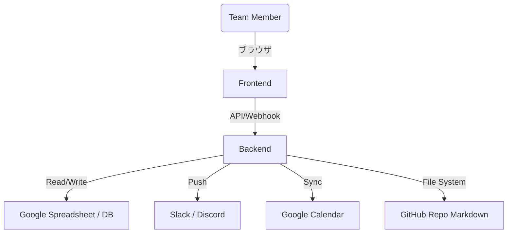

# viaGlyph Workspace App: アーキテクチャ設計 (Architecture)

## 1. システム全体構成

## 2. コンポーネント設計
### 2.1. フロントエンド (Frontend)
*   **技術スタック**: HTML/CSS/VanillaJS (初期フェーズ) → 段階的に React / Next.js へ移行。
*   **既存コードの活用**: `viaGlyph_workspace_app/index.html` と `store.js` を拡張し、ダッシュボードのルートとして再利用。

### 2.2. バックエンド (Backend / API)
*   **技術スタック**: Google Apps Script (既存のDailyLog用) ＋ Node.js または Python サーバー（新規機能用）。
*   **役割**:
    *   GAS: スプレッドシートを簡易データベースとした日報データの保存と読み込み。
    *   Node/Python: Markdownファイルの自動生成、ファイルシステムの読み書き、Slack/Discord Webhookの発火。

### 2.3. データ管理とストレージ
*   **構造化データ (日報履歴、ユーザー情報)**: Google Spreadsheet (GAS経由)。
*   **非構造化データ (議事録、タスク詳細)**: Gitリポジトリ内のMarkdownファイル (`meetings/`, `docs/`)。

## 3. インフラ・デプロイ環境
*   **フロントエンドホスティング**: Vercel または GitHub Pages。
*   **バックエンドAPI**: Vercel Serverless Functions または Google Cloud Run。
*   **定期実行 (Cron)**: GitHub Actions (毎日のリマインド通知やステータスチェック用)。
