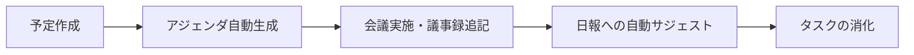

# viaGlyph Workspace App 運用ルール (manual_rules.md)

> 最終更新: 2026-06-04
> 対象: 全チームメンバー、およびワークスペースを操作する全AIエージェント

---

## 1. モジュール操作権限表

| モジュール | 人間（メンバー） | AI（Antigravity/Bot等） |
|-----------|----------------|------------------------|
| **ダッシュボード** | 閲覧のみ | 閲覧のみ（データは各ソースから集約） |
| **MeetingSync** | 予定の「作成（トリガー実行）」 | フォルダ・MDファイルの「自動生成」、リマインド通知 |
| **DailyLog** | 日報の「入力・編集」 | サジェスト内容の「推論・提示」、チャットへの通知 |
| **タスクMDファイル** | 完了（x）のチェック記入 | 進行状況の自動集計・ダッシュボードへの反映 |

### ルール
- 人間は原則として**「意思決定（トリガーの実行）」と「最終入力」**のみを行う。
- AIエージェントは「ファイルの自動生成」「定型文の入力」「通知」を担い、人間の操作をブロックしない。

---

## 2. SSOT（Single Source of Truth）

データの矛盾を防ぐため、以下の通りデータの「正（マスター）」を定義する。

| データ種別 | マスターデータ（SSOT） | 連携・表示先 |
|-----------|----------------------|------------|
| 会議の予定・日時 | **Google Calendar** | Workspace ダッシュボード, Discord通知 |
| 議事録・決定事項 | **ファイルシステム (`meetings/*.md`)** | DailyLogサジェスト |
| タスクの進行状態 | **ファイルシステム (`task.md` 等)** | Workspace ダッシュボード |
| 日報の履歴 | **Google Spreadsheet** | Workspace ダッシュボード |

### 矛盾時の優先ルール
- カレンダーとローカルMDの日時がズレている場合 → **カレンダーを正とする**（MDを上書き修正する）。

---

## 3. データライフサイクル

| 状態 | 条件 | アクション（AIが自動実行） |
|------|------|---------------------------|
| 会議15分前 | カレンダーの時間 | Discord/Slackへ直前リマインド通知（リンク付き） |
| 18:00 | 毎日定時 | 未提出者へ日報提出の催促通知 |
| 会議終了後 | アジェンダ更新検知 | 議事録の内容を解析し、日報用サジェストDBへ一時保存 |

---

## 4. 禁止事項

システムとデータの一貫性を保つため、以下の操作を固く禁ずる。

- [ ] AIエージェントがカレンダーのイベントを直接「削除」すること（キャンセルは人間が行う）。
- [ ] 人間が `meetings/YYYY-MM-DD/` フォルダ内のファイル名を勝手に変更すること（リンク切れ防止のため）。
- [ ] 人間が日報スプレッドシート（DB）の構造（列の順番など）を直接編集すること。
- [ ] エージェント間で同じファイルへの同時書き込みを発生させること（必ずキューまたは簡易ロックを経由する）。
